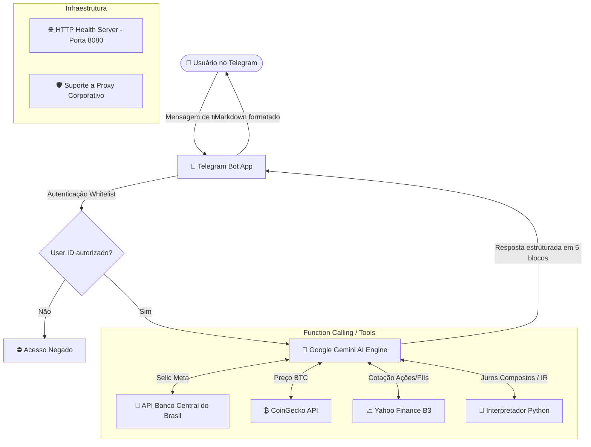

# 💼 Jeff Investidor - Copiloto de Inteligência Financeira

[](https://www.python.org/)
[](https://core.telegram.org/bots)
[](https://ai.google.dev/)
[](https://www.docker.com/)
[](LICENSE)

> **Jeff** é um copiloto pessoal de investimentos e alocação de capital baseado em Inteligência Artificial para o **Telegram**, desenvolvido com o SDK moderno do **Google Gemini** e integração em tempo real com APIs financeiras do mercado brasileiro e global.

---

## 📌 O Que É o Jeff Investidor?

O Jeff atua como um **Analista Financeiro Sênior e Alocador de Capital**, combinando os modelos mentais e filosofias dos maiores investidores do mundo (**Ray Dalio, Warren Buffett, Charlie Munger e Nassim Taleb**) com execução prática, disciplinada e sem "achismos".

### 🎯 Proposta & Filosofia de Investimento
- **Objetivo Central:** Construção de patrimônio e independência financeira a longo prazo, com metas definidas no seu perfil pessoal.
- **Gestão de Risco em Fases:**
  - **Fase 1 (Fundação):** Construção e blindagem da Reserva de Emergência (ex: CDB com 100% do CDI e liquidez diária).
  - **Fase 2 (Acumulação):** Alocação inteligente em ativos geradores de renda passiva (Fundos Imobiliários - FIIs, Ações de valor e dividendos, Renda Fixa atrelada à inflação - IPCA+ e exposição assimétrica a Bitcoin).
- **Aporte Disciplinado:** Aplicação estrita da **Regra dos 20%** sobre a renda líquida mensal configurada no seu perfil.
- **Perfil Privado:** Seus dados financeiros (renda, aporte, metas) ficam em `perfil.md` ou na variável `JEFF_USER_PROFILE`, nunca no repositório.

---

## 🏗️ Estrutura de Resposta Padrão (5 Blocos)

Toda e qualquer análise de ativos, oportunidades ou cenários de mercado gerada pelo Jeff segue rigidamente a seguinte metodologia de 5 partes:

```markdown
📊 Resumo rápido da situação
[Visão executiva e contextualizada do ativo ou cenário]

📈 Oportunidade
[Vantagens técnicas, retornos potenciais e upside]

⚠️ Riscos
[Riscos macroeconômicos, de liquidez, governança ou mercado]

🧠 Estratégia recomendada
[Passo a passo acionável com base na fase atual do investidor]

⏳ Horizonte de tempo
[Prazo de maturação do investimento: curto, médio ou longo prazo]
```

---

## 🛠️ Ferramentas & Integrações em Tempo Real (Function Calling)

Diferente de chatbots convencionais que inventam cotações, o Jeff possui **ferramentas ativas de chamada de função (Function Calling)** conectadas à internet para obter dados precisos:

| Ferramenta | Fonte de Dados | Descrição |
| :--- | :--- | :--- |
| `get_taxa_selic` | 🏦 **Banco Central do Brasil (SGS API 432)** | Taxa Selic Meta e CDI atualizados diretamente da fonte oficial do governo. |
| `get_bitcoin_price` | ₿ **CoinGecko API** | Preço e cotação do Bitcoin em tempo real cotado em Reais (BRL). |
| `get_asset_price` | 📈 **Yahoo Finance (`yfinance`)** | Cotações das ações (`PETR4`, `VALE3`), FIIs (`MXRF11`, `HGLG11`) e BDRs da B3. |
| `code_interpreter` | 🧮 **Ambiente Python Isolado** | Execução de cálculos matemáticos de juros compostos, tabela regressiva de IR e simulações temporais. |

---

## 📐 Arquitetura do Sistema



---

## 📁 Estrutura do Repositório

```text
JeffInvestidor/
├── bot_jeff.py          # Código principal: bot do Telegram, prompt do Jeff, tools e handlers
├── test_tools.py        # Script automatizado para validação offline das ferramentas financeiras
├── requirements.txt     # Dependências Python do projeto
├── Dockerfile           # Imagem Docker otimizada baseada em Python 3.12-slim
├── docker-compose.yml   # Orquestração simplificada com Docker Compose
├── Procfile             # Configuração de processo para deploy em nuvem (Render, Railway, Heroku)
├── .env.example         # Modelo documentado das variáveis de ambiente necessárias
├── perfil.example.md    # Modelo do perfil financeiro (copie para perfil.md, que é ignorado pelo Git)
├── .gitignore           # Filtro para ignorar arquivos temporários, segredos e SO
├── .dockerignore        # Filtro para build otimizado de contêiner
├── LICENSE              # Licença de código aberto (MIT)
└── README.md            # Documentação completa do projeto
```

---

## 🚀 Como Executar Localmente

### 1. Pré-requisitos
- **Python 3.12+** instalado na máquina.
- Git instalado.
- Conta no Telegram.
- Chave de API do **Google AI Studio (Gemini)**.

### 2. Clonar o Repositório
```bash
git clone https://github.com/Gabrielferragute/JeffInvestidor.git
cd JeffInvestidor
```

### 3. Criar e Ativar Ambiente Virtual
```bash
# Windows
python -m venv venv
.\venv\Scripts\activate

# Linux / macOS
python3 -m venv venv
source venv/bin/activate
```

### 4. Instalar as Dependências
```bash
pip install --upgrade pip
pip install -r requirements.txt
```

### 5. Configurar as Variáveis de Ambiente
Copie os arquivos de exemplo:
```bash
cp .env.example .env
cp perfil.example.md perfil.md   # preencha com sua renda, aporte e metas
```
> Em deploy na nuvem, use a variável `JEFF_USER_PROFILE` no lugar do `perfil.md`.
Edite o arquivo `.env` com suas credenciais:
```ini
# Token gerado pelo @BotFather no Telegram
JEFF_TELEGRAM_TOKEN=123456789:ABCdefGhIJKlmNoPQRstuVWXyz

# Seu ID numérico do Telegram (envie uma mensagem para @userinfobot para descobrir)
JEFF_ALLOWED_USER_ID=123456789

# Sua chave de API do Google AI Studio (https://aistudio.google.com/)
JEFF_LLM_API_KEY=AIzaSy...

# Porta para health check HTTP (opcional, padrão 8080)
PORT=8080
```

### 6. Validar as Ferramentas (Testes Rápidos)
Execute o script de testes para verificar a conexão com as APIs antes de rodar o bot:
```bash
python test_tools.py
```
Se tudo estiver correto, você verá a confirmação:
```text
[SUCCESS] Todos os testes das ferramentas passaram com sucesso!
```

### 7. Iniciar o Bot
```bash
python bot_jeff.py
```

---

## 🐳 Executando com Docker

### Usando Docker Compose (Recomendado)
Certifique-se de ter preenchido o `.env` e execute:
```bash
docker compose up -d --build
```
Para visualizar os logs em tempo real:
```bash
docker compose logs -f
```

### Usando Docker CLI
```bash
docker build -t jeff-investidor .
docker run -d --name jeff-bot --env-file .env -p 8080:8080 jeff-investidor
```

---

## ☁️ Deploy em Nuvem (Render, Railway, Heroku, Fly.io)

O projeto já está preparado para deploy contínuo em ambientes de produção:

1. **Procfile:** Já configurado com o comando:
   ```text
   web: python bot_jeff.py
   ```
2. **Servidor HTTP de Health Check:** Um servidor HTTP nativo roda em background na porta informada em `$PORT` (padrão `8080`), respondendo `200 OK`. Isso evita que serviços como o **Render** derrubem o bot por falta de tráfego web.
3. **Resiliência a Redes Restritas:** Suporte nativo a proxies HTTP/HTTPS via variável `HTTPS_PROXY` com timeouts configurados.

### Passos no Render / Railway:
1. Conecte o repositório do GitHub.
2. Defina o tipo de serviço como **Web Service** (usando Docker ou Python).
3. Adicione as variáveis de ambiente (`JEFF_TELEGRAM_TOKEN`, `JEFF_ALLOWED_USER_ID`, `JEFF_LLM_API_KEY`) no painel de configurações.
4. O deploy será iniciado e o bot ficará online 24/7.

---

## 💬 Comandos e Exemplos de Uso no Telegram

### Comandos:
- `/start` - Apresentação do Jeff, metodologia, ferramentas e orientações.
- `/help` - Exibe os comandos e a estrutura padrão das análises.

### Perguntas de Exemplo:
- *"Qual é a taxa Selic hoje e quanto rende meu aporte mensal no CDB 100% CDI?"*
- *"Simule se eu investir R$ 500 por mês durante 5 anos com taxa média de 10% ao ano, quanto terei?"*
- *"O que você acha de eu comprar ações da Petrobras (PETR4) agora?"*
- *"Analise se vale a pena começar a aportar no fundo imobiliário MXRF11 para a minha fase atual."*
- *"Qual é o preço do Bitcoin hoje em Reais e qual percentual da carteira você recomenda ter?"*

---

## 🔒 Segurança

- **Whitelist de Usuário:** O bot só responde às requisições do ID definido em `JEFF_ALLOWED_USER_ID`. Qualquer outro usuário que tentar interagir receberá uma mensagem de acesso negado com o respectivo ID.
- **Segurança de Credenciais:** As chaves de API e tokens nunca são versionados no Git (protegidos pelo `.gitignore`).

---

## 📄 Licença

Distribuído sob a licença **MIT**. Consulte o arquivo [LICENSE](LICENSE) para obter mais detalhes.

---

<p align="center">
  Desenvolvido por <a href="https://github.com/Gabrielferragute">Gabriel Ferragute</a>
</p>
